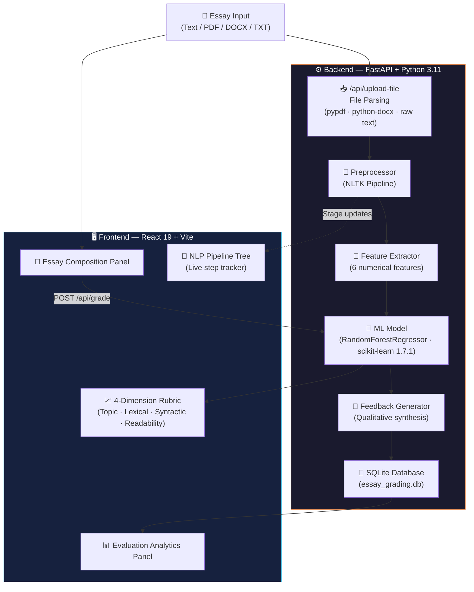
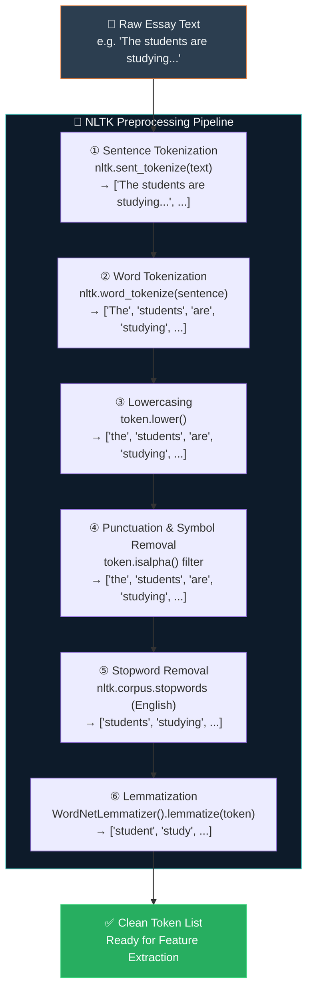
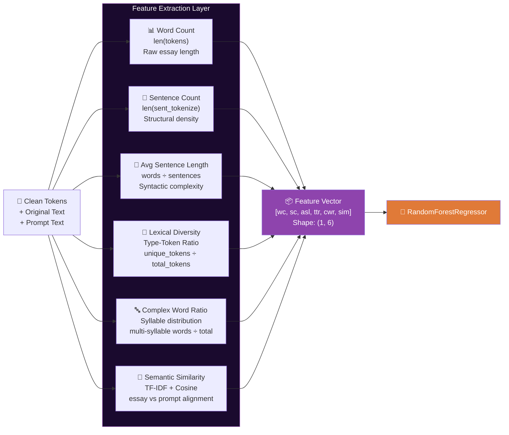
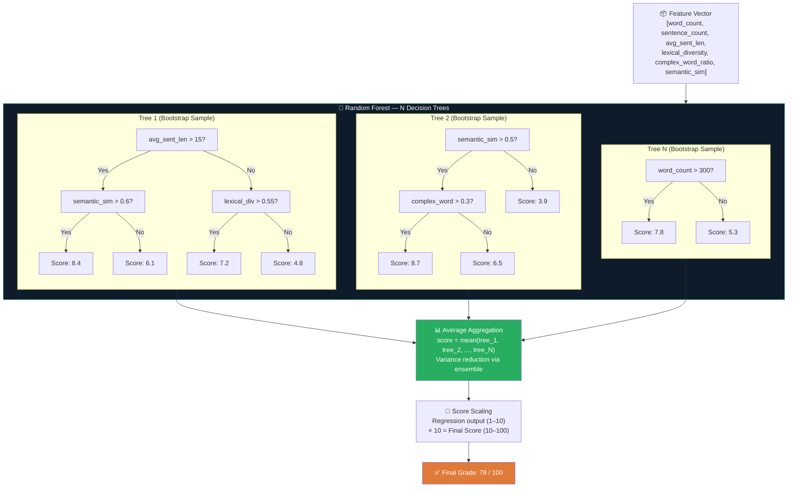
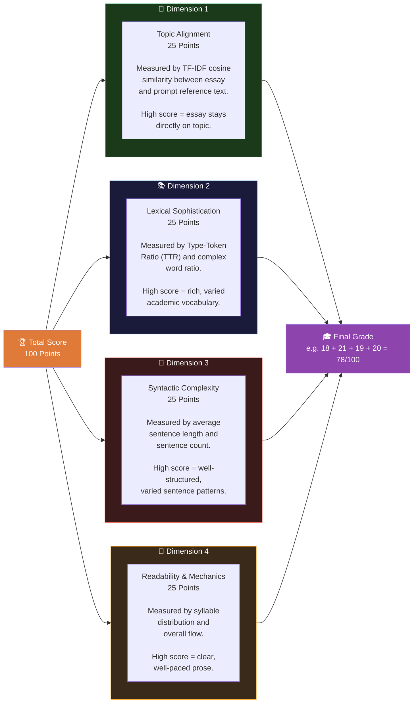
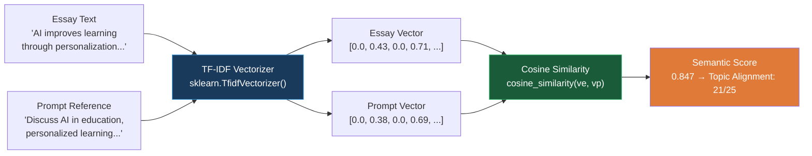
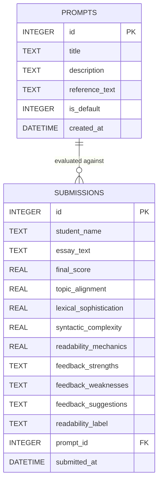
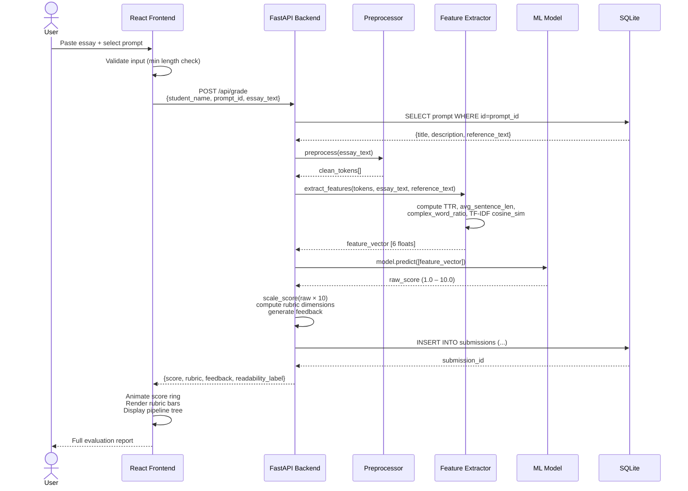

<div align="center">

# 🎓 REED — Essay Intelligence

**Recursive Evaluation & Editorial Diagnostics**

*An end-to-end NLP + Machine Learning system for automated academic essay assessment*

[](https://python.org)
[](https://fastapi.tiangolo.com)
[](https://scikit-learn.org)
[](https://react.dev)
[](https://vitejs.dev)
[](https://www.nltk.org)

[](https://reed-essay-intelligence-backend.onrender.com/api/health)
[](https://reed-essay-intelligence.vercel.app)
[](LICENSE)

---

*REED evaluates essays across four linguistic dimensions using a trained Random Forest model, NLTK text preprocessing, TF-IDF semantic alignment, and a React diagnostics interface — producing calibrated scores, rubric breakdowns, and actionable editorial feedback.*

</div>

---

## 📋 Table of Contents

| Section | Description |
|---|---|
| [🏗 System Architecture](#-system-architecture) | Full end-to-end component map |
| [🔬 NLP Pipeline](#-nlp-pipeline) | Text preprocessing stages |
| [🧬 Feature Extraction](#-feature-extraction) | All features fed to the ML model |
| [🤖 Machine Learning Model](#-machine-learning-model) | Random Forest algorithm deep dive |
| [📐 4-Dimension Rubric](#-4-dimension-rubric) | Scoring breakdown |
| [📊 TF-IDF & Cosine Similarity](#-tf-idf--cosine-similarity) | Semantic alignment math |
| [💾 Database Schema](#-database-schema) | SQLite entity relationships |
| [🔁 API Request Lifecycle](#-api-request-lifecycle) | Frontend ↔ Backend sequence |
| [📡 API Reference](#-api-reference) | All endpoints |
| [🚀 Running Locally](#-running-locally) | Setup instructions |
| [🧰 Tech Stack](#-tech-stack) | Full dependency list |

---

## 🏗 System Architecture

REED is a full-stack system with five distinct layers: input ingestion, NLP preprocessing, ML inference, persistence, and presentation.



---

## 🔬 NLP Pipeline

REED's preprocessing pipeline transforms raw essay text into a clean, normalized token sequence before feature extraction.



### Pipeline Stage Details

| Stage | Library / Method | Purpose |
|---|---|---|
| Sentence Boundary Detection | `nltk.sent_tokenize()` | Splits text into individual sentences for syntactic analysis |
| Word Tokenization | `nltk.word_tokenize()` | Splits sentences into individual word tokens |
| Lowercasing | `str.lower()` | Normalizes case for consistent vocabulary matching |
| Non-alpha Filtering | `str.isalpha()` | Removes punctuation, numbers, and special characters |
| Stopword Removal | `nltk.corpus.stopwords.words('english')` | Removes high-frequency function words (the, is, at...) |
| Lemmatization | `WordNetLemmatizer().lemmatize()` | Reduces words to their base/dictionary form |

---

## 🧬 Feature Extraction

After preprocessing, REED computes a **6-dimensional numerical feature vector** that is fed directly into the Random Forest model.



### Feature Vector Specification

| Index | Feature Name | Formula / Method | Range | Contribution |
|---|---|---|---|---|
| 0 | `word_count` | `len(tokens)` | 0 → ∞ | Essay length baseline |
| 1 | `sentence_count` | `len(sent_tokenize(text))` | 1 → ∞ | Structural paragraph density |
| 2 | `avg_sentence_length` | `word_count / sentence_count` | 1 → 60 | Syntactic maturity |
| 3 | `lexical_diversity` | `unique_tokens / total_tokens` (TTR) | 0.0 → 1.0 | Vocabulary richness |
| 4 | `complex_word_ratio` | `polysyllabic_words / total_words` | 0.0 → 1.0 | Academic register |
| 5 | `semantic_similarity` | TF-IDF cosine similarity vs. prompt | 0.0 → 1.0 | On-topic alignment |

---

## 🤖 Machine Learning Model

### Algorithm: Random Forest Regressor

REED uses `sklearn.ensemble.RandomForestRegressor` — an ensemble learning method that builds multiple decision trees and averages their predictions to produce a continuous score.



### Why Random Forest?

| Property | Benefit for Essay Grading |
|---|---|
| **Ensemble averaging** | Reduces overfitting to individual quirky training essays |
| **Non-linear decision boundaries** | Captures complex interactions between features (e.g., high vocab + low coherence) |
| **Feature importance** | Identifies which linguistic features matter most |
| **Regression output** | Produces continuous scores (not just class labels) |
| **Robust to outliers** | Single unusual essays don't skew the entire model |
| **No feature scaling required** | Works directly on raw feature magnitudes |

### Model Artifact

```
backend/trained_model.joblib   — 4.56 MB
Trained with: scikit-learn 1.7.1
Input shape:  (n_samples, 6)
Output range: 1.0 – 10.0  (calibrated 10-band regression)
Final output: score × 10 → 10 – 100 point scale
```

---

## 📐 4-Dimension Rubric

REED breaks the total score (100 points) across four equally-weighted linguistic dimensions (25 points each).



### Rubric Band Labels

| Score Range | Band Label | Descriptor |
|---|---|---|
| 90 – 100 | **Exceptional** | Publication-ready academic writing |
| 80 – 89 | **Proficient** | Strong academic writing, minor refinements needed |
| 70 – 79 | **Developing** | Competent writing with notable areas for growth |
| 60 – 69 | **Emerging** | Basic structure present; significant revision needed |
| 50 – 59 | **Beginning** | Foundational issues in most dimensions |
| < 50 | **Needs Attention** | Substantial revision across all dimensions |

---

## 📊 TF-IDF & Cosine Similarity

REED uses **Term Frequency–Inverse Document Frequency (TF-IDF)** to measure how semantically aligned an essay is with the prompt topic.

### TF-IDF Formula

For a term $t$ in document $d$ from corpus $D$:

$$\text{TF-IDF}(t, d, D) = \underbrace{\frac{f_{t,d}}{\sum_{t' \in d} f_{t',d}}}_{\text{Term Frequency}} \times \underbrace{\log\left(\frac{|D|}{|\{d \in D : t \in d\}|}\right)}_{\text{Inverse Document Frequency}}$$

Where:
- $f_{t,d}$ = raw count of term $t$ in document $d$
- $|D|$ = total number of documents
- $|\{d \in D : t \in d\}|$ = number of documents containing $t$

### Cosine Similarity Formula

$$\text{similarity}(A, B) = \cos(\theta) = \frac{\vec{A} \cdot \vec{B}}{|\vec{A}|\ |\vec{B}|}= \frac{\sum_{i=1}^{n} A_i B_i}{\sqrt{\sum_{i=1}^{n} A_i^2}\ \sqrt{\sum_{i=1}^{n} B_i^2}}$$

Where $\vec{A}$ = TF-IDF vector of the essay, $\vec{B}$ = TF-IDF vector of the prompt reference.

**Result**: A value in $[0.0, 1.0]$ where 1.0 means the essay perfectly mirrors the prompt's vocabulary distribution.



---

## 📐 Type-Token Ratio (TTR)

TTR quantifies **lexical diversity** — the variety of vocabulary used in an essay.

$$\text{TTR} = \frac{|\text{unique tokens}|}{|\text{total tokens}|}$$

**Example:**
- Essay: *"The cat sat on the mat. The cat ate the rat."*
- Tokens: `[the, cat, sat, on, the, mat, the, cat, ate, the, rat]` → 11 total
- Unique: `[the, cat, sat, on, mat, ate, rat]` → 7 unique
- **TTR = 7/11 = 0.636**

| TTR Range | Interpretation |
|---|---|
| 0.80 – 1.00 | Exceptional lexical diversity |
| 0.60 – 0.79 | Good vocabulary range |
| 0.40 – 0.59 | Average — some repetition |
| 0.20 – 0.39 | High repetition, limited vocabulary |
| 0.00 – 0.19 | Very repetitive writing |

> **Note:** TTR is length-sensitive — shorter texts naturally score higher. REED combines TTR with complex word ratio to produce a robust `lexical_diversity` feature.

---

## 💾 Database Schema

REED stores all grading submissions and custom prompts in a local SQLite database (`essay_grading.db`).



---

## 🔁 API Request Lifecycle



---

## 🌲 NLP Pipeline Execution Tree (UI)

When a grade request is submitted, the frontend displays a **live execution tree** tracking each pipeline stage in real time:

```
🌲 NLP Pipeline Execution
│
├── ① Tokenization & Boundary Lemmatization          ✅ Complete
│       NLTK word + sentence tokenizers
│
├── ② Linguistic Feature Extraction                   ✅ Complete
│       TTR · avg sentence length · syllable count
│
├── ③ Semantic Cosine Alignment                       ⟳ Running...
│       TF-IDF vectorizer · cosine similarity
│
├── ④ Supervised ML Regression                        ⏳ Pending
│       RandomForestRegressor · feature vector (1×6)
│
└── ⑤ Actionable Editorial Synthesis                  ⏳ Pending
        Strengths · weaknesses · improvement suggestions
```

Each stage lights up sequentially with animated status indicators during API processing.

---

## 📡 API Reference

**Base URL:** `https://reed-essay-intelligence-backend.onrender.com`

| Method | Endpoint | Description | Request Body |
|---|---|---|---|
| `GET` | `/api/health` | Health check — returns status + version | — |
| `GET` | `/api/prompts` | List all evaluation prompts | — |
| `POST` | `/api/prompts` | Create a custom prompt | `{title, description, reference_text}` |
| `POST` | `/api/grade` | Grade an essay | `{student_name, prompt_id, essay_text}` |
| `POST` | `/api/upload-file` | Parse PDF/DOCX/TXT → plain text | `multipart/form-data: file` |
| `GET` | `/api/history` | Fetch recent submission history | `?limit=20` |

### `POST /api/grade` — Request / Response

**Request:**
```json
{
  "student_name": "Jane Doe",
  "prompt_id": 1,
  "essay_text": "Artificial intelligence is transforming..."
}
```

**Response:**
```json
{
  "score": 78,
  "rubric": {
    "topic_alignment": 20,
    "lexical_sophistication": 21,
    "syntactic_complexity": 19,
    "readability_mechanics": 18
  },
  "feedback": {
    "strengths": ["Strong semantic alignment with the prompt topic"],
    "weaknesses": ["Average sentence length could be increased"],
    "suggestions": ["Vary sentence structure with compound-complex sentences"]
  },
  "readability_label": "Developing",
  "features": {
    "word_count": 412,
    "sentence_count": 22,
    "avg_sentence_length": 18.7,
    "lexical_diversity": 0.61,
    "complex_word_ratio": 0.28,
    "semantic_similarity": 0.79
  }
}
```

---

## 🚀 Running Locally

### Prerequisites

- Python 3.11.x
- Node.js 20+
- pnpm (or npm)

### Backend

```bash
cd backend
python -m venv venv
venv\Scripts\activate          # Windows
# source venv/bin/activate     # macOS/Linux

pip install -r requirements.txt
python -m nltk.downloader punkt stopwords wordnet

uvicorn main:app --host 127.0.0.1 --port 8080 --reload
```

Backend will be live at: `http://127.0.0.1:8080`  
API docs (Swagger UI): `http://127.0.0.1:8080/docs`

### Frontend

```bash
cd frontend
pnpm install

# Create .env.local
echo VITE_API_URL=http://127.0.0.1:8080/api > .env.local

pnpm run dev
```

Frontend will be live at: `http://localhost:5173`

### Full Local Stack (single command — PowerShell)

```powershell
# Terminal 1 — Backend
cd backend; python -m uvicorn main:app --port 8080 --reload

# Terminal 2 — Frontend
cd frontend; pnpm run dev
```

---

## 🧰 Tech Stack

### Backend

| Package | Version | Role |
|---|---|---|
| FastAPI | 0.115.6 | REST API framework |
| Uvicorn | 0.32.1 | ASGI server |
| scikit-learn | 1.7.1 | RandomForestRegressor, TfidfVectorizer |
| NLTK | 3.9.1 | Tokenization, stopwords, lemmatization |
| NumPy | 2.2.0 | Numerical feature array operations |
| SciPy | 1.17.1 | Statistical utilities |
| Pydantic | 2.10.4 | Request/response validation |
| pypdf | 5.1.0 | PDF text extraction |
| python-docx | 1.1.2 | DOCX text extraction |
| python-dotenv | 1.2.4 | Environment variable management |
| joblib | (via sklearn) | Model serialization |
| SQLite3 | (stdlib) | Persistent submission storage |

### Frontend

| Package | Version | Role |
|---|---|---|
| React | 19 | UI component framework |
| Vite | 8 | Build tool + dev server |
| CSS Variables | — | Design token system (terracotta `#e07a38`) |

### Infrastructure

| Service | Platform | URL |
|---|---|---|
| Backend API | Render (Free) | https://reed-essay-intelligence-backend.onrender.com |
| Frontend | Vercel (Hobby) | https://reed-essay-intelligence.vercel.app |
| Version Control | GitHub | https://github.com/wraith-klu/REED-essay-intelligence |

---

## 🗂 Project Structure

```
REED-essay-intelligence/
├── backend/
│   ├── main.py                 # FastAPI app + all route handlers
│   ├── ml_model.py             # RandomForestRegressor loader
│   ├── preprocessor.py         # NLTK tokenize → lemmatize pipeline
│   ├── feature_extractor.py    # TTR, cosine sim, syllable features
│   ├── feedback_generator.py   # Qualitative feedback synthesis
│   ├── database.py             # SQLite schema + CRUD operations
│   ├── trained_model.joblib    # Serialized trained model (4.56 MB)
│   ├── requirements.txt        # Python dependencies (pinned)
│   └── .python-version         # 3.11.9 (Render compatibility)
│
├── frontend/
│   ├── src/
│   │   ├── App.jsx             # Main React component
│   │   └── App.css             # CSS variable design system
│   ├── index.html
│   ├── vite.config.js
│   └── package.json
│
├── .python-version             # 3.11.9
├── .gitignore
└── README.md
```

---

## 📄 License

MIT License — see [LICENSE](LICENSE) for details.

---

<div align="center">

Built with ❤️ for academic assessment automation

**REED** · Recursive Evaluation & Editorial Diagnostics

</div>
